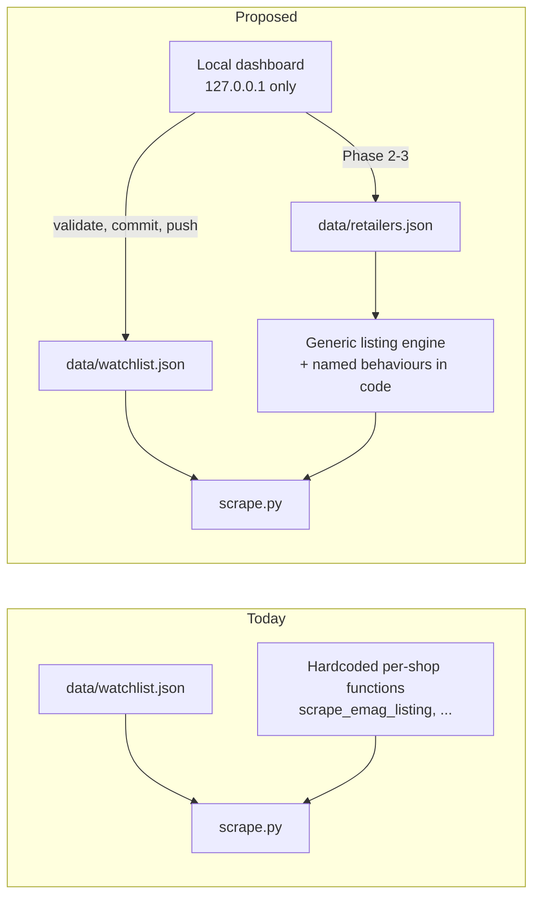
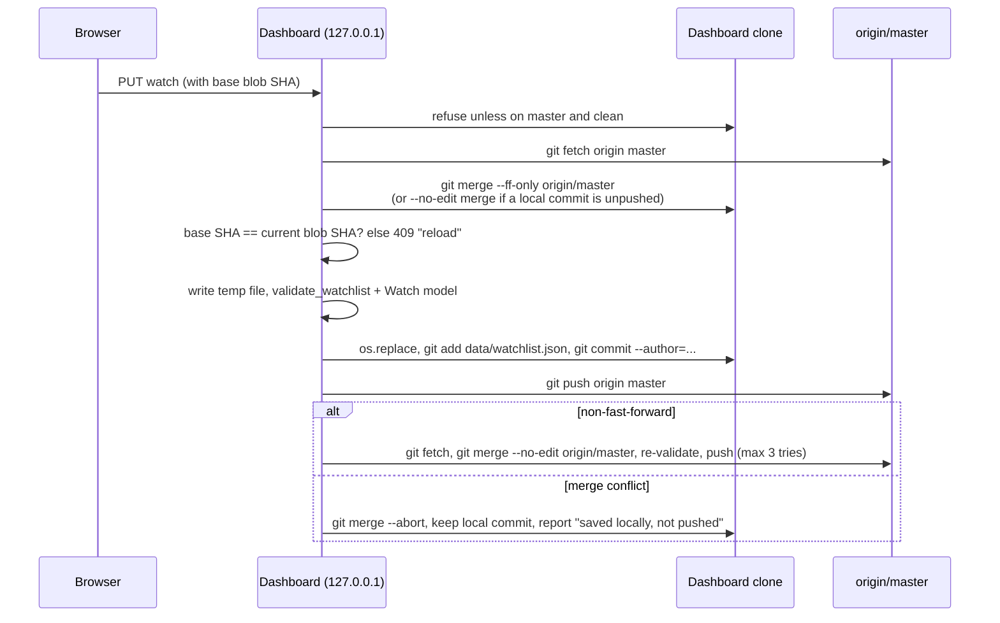

# Design spike: local dashboard and data-driven retailer config

Status: **proposal, not implemented.** Written 2026-10-17 from a read-only
review of the code at commit `6beab35`. Nothing in `scripts/`,
`bf_price_monitor/`, `data/`, `tests/` or `.github/workflows/` was changed,
and no live network call or scrape was made.

## 1. Question and answer

**Assumption under test:** eMAG, PC Garage and Flanco can each be described
by selectors and URL patterns in a data file, plus a few named behaviours that
stay in code.

**Answer: the assumption holds for all three shops.** The three scrapers
(`scripts/scrape.py:935-1147`) are copies of one template. Everything that
differs between them is either a string (URL, selector, constant) or a choice
between a small number of existing code paths. The one part that needs real
design work is stock-status mapping. It fits into a closed, four-condition
rule list with no regular expressions and no code execution (section 4).

**The assumption is not the real risk.** The review found three things that
matter more than whether shops fit a schema:

1. `scrape.py` never reads a watch's `enabled` field. A dashboard "disable"
   switch would do nothing in production (section 6.1).
2. The `persist` job in `monitor.yml` can overwrite a dashboard edit to
   `data/watchlist.json` with an older copy (trap 1, section 7).
3. Turning a shop off without touching the health logic would trigger a false
   "SCRAPER BREAKDOWN" alert after two runs. Altex already hit this exact
   trap (section 6.2).

## 2. How the pieces fit today and after the change



## 3. Fit matrix

Verdict labels:

- **DATA**: can live in the config file as a plain value.
- **NAMED**: stays in code; the config picks one implementation by name.
- **ENGINE**: identical for all three shops today, so it is part of the shared
  engine and needs no per-shop config. Not a leftover.
- **CODE-ONLY**: cannot be described declaratively.

| Field | eMAG | PC Garage | Flanco | Verdict |
|---|---|---|---|---|
| Search URL | `https://www.emag.ro/search/{q}` (`scrape.py:943`) | `https://www.pcgarage.ro/cauta/?q={q}` (`:1020`) | `https://www.flanco.ro/catalogsearch/result/?q={q}` (`:1099`) | DATA (template with one `{query}` placeholder) |
| Query encoding | `query.replace(' ', '+')`, nothing else encoded | same | same | NAMED (`plus`; only one exists). See security note S3. |
| Pagination | none, first page only | none | none | not applicable |
| Fetch method | `fetch()`, plain `requests` (`:944`, `:875-911`) | `fetch_with_browser()`, stealth Chromium (`:1021`, `:782-872`) | `fetch_with_browser()` (`:1100`) | NAMED (`http` or `browser`) |
| UA rotation | `_pick_user_agent()` per request (`:879`) | per browser context (`:298`) | per browser context | ENGINE |
| Domain pacing | 5 s floor per site name (`:71-81`) | same | same | ENGINE |
| Retry and backoff | 403/429 retried at 5/10/20 s (`:192-194`, `:889-897`); scraper-level retry (`:139-162`) | same, plus context reset on scraper retry (`:1188`) | same as PC Garage (`:1189`) | ENGINE (context reset follows from `fetch: browser`) |
| Listing-ready selector | none (no browser, no wait) | `.product_box` (`:105`) | `li.product-item` (`:106`) | DATA (required when `fetch: browser`) |
| Card selector | `.card-item` (`:950`) | `.product_box` (`:1027`) | `li.product-item` (`:1106`) | DATA |
| Title and link | `.card-v2-title` (text and `href` on one element, `:951`) | `.product_box_name a` (`:1028`) | `.product-item-link` (`:1107`) | DATA (one selector; all three shops put title and link on one element) |
| Price (CSS layer) | `.product-new-price` (`:952`) | `.product_box_price_container p.price` (`:1029`) | `.price-box.price-final_price .special-price .price` (`:1108`) | DATA |
| Price text format | `parse_price()`, Romanian `1.234,56 Lei` (`:526-536`) | same | same | NAMED (`ro_lei`; only one exists) |
| Image | not extracted | not extracted | not extracted | not applicable; do not add |
| Reference (30-day) price | none | none | `.pretVechi .pricePrp .price` (`:1117`), optional (`:1142-1145`) | DATA (optional selector). The rule that it is display-only and never feeds `thirty_day_low` stays in code (`:1109-1116`). |
| Price layer order | JSON-LD, then semantic attributes, then CSS, then AI stub plus failure log (`:959-967`) | identical (`:1036-1044`) | identical (`:1124-1132`) | ENGINE. No per-site deviation exists. |
| Stock status | card text and the card's own `data-availability-id` attribute (`:914-932`) | class and text of `.product_box_availability` (`:988-1009`) | class of `.stocky-txt`, partly substring match (`:1059-1083`) | DATA through the rule list in section 4 (the hardest field) |
| Seller and marketplace flag | always `None` / `None` (`:981-982`) | constant `"PC Garage"` / `False` (`:1052-1053`) | constant `"Flanco"` / `False` (`:1139-1140`) | DATA, but a **trust field**: `is_marketplace: false` lets `seller_policy: "trusted"` watches alert (`:1644-1649`) |
| Cloudflare and challenge handling | `fetch()` treats 403/503 or challenge markup as blocked (`:899-905`) | `fetch_with_browser()` waits out the challenge and re-checks (`:815-822`, `:864-869`) | same as PC Garage | ENGINE (follows from the fetch method) |
| Token-match contract | `title_matches_query()` (`:764-771`) before price extraction (`:956`) | same (`:1033`) | same (`:1121`) | ENGINE. Not configurable on purpose: `qa_watchlist.py` relies on the same contract (`qa_watchlist.py:283-285`). |
| URL canonicalization | `canonicalize_url()` (`:724-741`); the global tracking-param list includes the eMAG-specific `emag_click_id` (`:710`) | same | same | ENGINE |
| Retailer SKU | segment after `/pd/`, must match `^[A-Z0-9]{6,16}$` (`identity.py:56-68`) | last path segment, lowercased, at least 2 segments (`identity.py:71-78`) | last segment, must end in `.html`, lowercased (`identity.py:81-88`) | NAMED (`sku_adapter`). Changing it re-keys SQLite offer ids, so it must be locked once a shop has observations. |
| Display name | `STORE_DISPLAY_NAMES` (`scrape.py:214-219`) | same | same | DATA |
| Allowed host | `RETAILER_HOSTS` in `qa_watchlist.py:46-51` | same | same | DATA; it doubles as the network allowlist (section 7, trap 4) |
| Robots.txt scope | `/product/` disallowed, never requested (`:937`) | `/detalii-produs/` disallowed (`:1014`) | robots.txt itself is challenge-gated and unreadable (`:1088-1091`) | CODE-ONLY in the sense that no schema can verify it. Recorded as a required human-review field. |

## 4. The stock-status rule list

Stock status is the only field where the three shops genuinely differ in
logic. A closed rule list reproduces all three exactly:

- A shop has an optional `target` selector. With no target, conditions are
  checked on the card itself. If a target is set and missing from the card,
  the result is `unknown`, which is what PC Garage (`:999-1000`) and Flanco
  (`:1072-1073`) do today.
- Rules are checked **in order; the first match wins**. Order is
  load-bearing: eMAG's limited-stock text "ultimul produs in stoc" also
  contains the in-stock needle "in stoc" (`:928-931`).
- A rule matches when **all** of its conditions hold. PC Garage needs this:
  class `instock` plus text "limitat" means limited stock (`:1007-1008`).
- Four condition types, no others:
  - `class_has`: the target has this exact class.
  - `class_contains`: some class on the target contains this substring
    (Flanco's `out-of-stock` / `sold-out` check, `:1075`).
  - `attr_equals`: an attribute on the target equals this value (eMAG's
    `data-availability-id`, `:927-931`).
  - `text_contains`: the target's lowercased text contains this substring.
    No diacritic folding, to match today's behaviour exactly.
- No regular expressions anywhere, so no catastrophic-backtracking risk from
  user-edited patterns.
- If nothing matches, the result is `unknown`.

**Equivalence caveat for Phase 3:** eMAG reads card text with a space
separator (`get_text(" ", strip=True)`, `:924`), but PC Garage reads it with no
separator (`get_text(strip=True)`, `:1002`). The engine should always use the
space separator. For PC Garage's only needle ("limitat") the results are
identical, but the Phase 3 equivalence tests must prove that on every
fixture, not assume it.

### Evidence gathered during the spike

I checked this with a throwaway script kept outside the repo. It made no
network calls and changed no repo files.

- `docs/design/retailers.draft.json` validates against the section 8 model.
  The model rejects an `http://127.0.0.1/...` search URL, a URL with extra
  braces, and a browser shop with no listing-ready selector.
- The draft's stock rules were replayed on every card in every existing
  fixture (`tests/fixtures/{emag,pcgarage,flanco}/*.html`, 12 cards) and on 12
  synthetic edge cards covering the branches the fixtures don't reach. Those
  edge cards included PC Garage's "limitat" split across tags and Flanco's
  `sold-out` substring. The rules matched the real `*_stock_status()`
  functions on all 24 cards, with 0 mismatches.
- `urllib.parse.quote_plus` gives the same result as `replace(' ', '+')` for
  all 4 live watch queries.

Limit: 12 real cards is a small sample. Phase 3's equivalence tests and a
live selector check (the `selector-drift-detector` agent) are still required
before any switch-over.

## 5. Per-shop verdicts

| Shop | Verdict | Leftovers that stay in code (all chosen by name) |
|---|---|---|
| eMAG | **FITS** | `fetch: http`; `sku_adapter: emag`; `price_format: ro_lei`; `query_encoding: plus` |
| PC Garage | **FITS** | `fetch: browser`; `sku_adapter: pcgarage`; `price_format: ro_lei`; `query_encoding: plus` |
| Flanco | **FITS** | `fetch: browser`; `sku_adapter: flanco`; `price_format: ro_lei`; `query_encoding: plus`. The legal rule that `reference_price` is display-only stays in code. |
| Altex (not in scope) | **DOES NOT FIT** | Client-rendered Next.js listing behind Akamai (`scrape.py:1167-1183`, README "Site status"). Kept as `enabled: false` or as today's placeholder. It is a fair preview of what a fourth shop would look like. |

Shared engine code, which is not a per-shop leftover: layered price
extraction, challenge handling, retries and pacing, the token-match contract,
URL canonicalization, and health and quarantine tracking.

### Named-behaviour list

| Config key | Allowed values | Code it selects |
|---|---|---|
| `fetch` | `http`, `browser` | `fetch()` or `fetch_with_browser()` plus `with_retry(site_name=...)` |
| `query_encoding` | `plus` | Space to `+`. Phase 3 should switch the implementation to `urllib.parse.quote_plus` (security note S3), which gives identical URLs for every current query. |
| `price_format` | `ro_lei` | `parse_price()` |
| `sku_adapter` | `emag`, `pcgarage`, `flanco`, `generic_last_segment` | `bf_price_monitor/identity.py` adapters |

Adding a value to this list is a code change with tests, never a config edit.

## 6. Findings outside the schema question

### 6.1 Watch fields with no runtime consumer

The dashboard must only offer fields that actually change behaviour. Grepping
`scripts/` and `bf_price_monitor/` for each watch field found:

| Field | Read by | Effect today |
|---|---|---|
| `site`, `query` | `scrape.py:1211`, `:1540`; `notify.py:1090` | live |
| `target_price`, `min_drop_percent`, `atl_policy` | `scrape.py:1633-1636` | live |
| `seller_policy` | `scrape.py:1645` | live |
| `cooldown_hours` | `notify.py:923-943` (minimum per site) | live |
| `channels` | `notify.py:1074-1093` (keyed by site and query) | live |
| `enabled` | `scrape.py` `_watch_retailers`; notify's cooldown and channel loaders; `qa_watchlist.py:339`; `report.py:435` | live since dashboard Phase 1 slice A: a disabled watch is not fetched, does not alert, and writes no health record |
| `cadence_minutes` | nothing | ignored (the cron schedule is fixed) |
| `track_all_time_low` | nothing in the live path | ignored (`atl_policy` is what is read) |
| `drop_rule`, `drop_threshold` | nothing (DECISIONS 2026-09-23) | ignored |
| `owner`, `id` | nothing in the live path | identifiers only |

Phase 1 must either make `scrape.py` honour `enabled` or not show the switch.
The dashboard should hide `cadence_minutes`, `track_all_time_low`, `drop_rule`
and `drop_threshold`, or show them as "not used yet", so nobody tunes a dial
that is not connected.

### 6.2 "Shop off" must not look like "shop broken"

`_run()` writes a health record for every store it touched that is in
`SCRAPERS` and not quarantined or cooling down (`scrape.py:1695-1739`). A shop
skipped because it is disabled would record `products_parsed: 0`. Two such
runs while another shop succeeds meet the quarantine rule
(`scrape.py:1363-1389`) and raise "SCRAPER BREAKDOWN" (`:1745-1750`). This is
the same false alarm that placeholder scrapers were excluded from fan-out to
avoid (DECISIONS 2026-09-28, #59 addendum). Phase 2 must exclude disabled
shops from fan-out and from health records, exactly like placeholders.

### 6.3 Smaller notes

- **Docker mode bakes the watchlist into the image.** `.dockerignore` allows
  `data/watchlist.json` into the build (`tests/test_run_loop.py:195-201`). A
  dashboard edit reaches Docker mode only after a rebuild or a mounted file.
  Docker mode is not the production path, so this is a documentation item.
- **Test runs would dirty the checkout.** `data/extraction_failures.jsonl` is
  not git-ignored, and `log_extraction_failure()` appends to it
  (`scrape.py:684-701`). A Test button run must redirect it and `DEBUG_DIR`
  to a temporary folder.
- **Stale project instruction.** `CLAUDE.md` still says the Watch has no
  retailer field "tracked as #56", but #56 is closed and was resolved via
  Option A (DECISIONS 2026-09-24). Not changed here; flagged for a separate
  edit.

## 7. The five traps

### Trap 1: will the persist job overwrite a dashboard edit?

**Yes, there is a real window.** The sequence:

1. The scrape job checks out master at time T0 (`monitor.yml:126-132`).
2. It uploads `data/watchlist.json` from that checkout in the `price-data`
   artifact (`monitor.yml:303-311`).
3. The persist job checks out the *current* tip, which may now include a
   dashboard edit pushed after T0 (`monitor.yml:369-371`).
4. It extracts the artifact over `data/` (`monitor.yml:373-376`), replacing
   the newer watchlist with the T0 copy.
5. `git add data/price_history.json data/watchlist.json` (`monitor.yml:382`)
   stages that older copy as a change, so the bot's "update price history"
   commit silently reverts the dashboard edit.

The window spans the whole scrape, analyze and notify job, which is minutes
long. `scrape.py` never writes `data/watchlist.json`: its only use is the
read at `scrape.py:1415`. So the file has no reason to be in the artifact or
the commit at all.

**Smallest fix (two lines in `monitor.yml`, Phase 1):** remove
`data/watchlist.json` from the `upload-artifact` paths (line 309) and from the
persist job's `git add` (line 382). Add a test that the workflow neither
uploads nor stages the watchlist. The README's "How it works" step 4 should
then say only price history is committed. This is better than "write only if
the scrape changed it", because nothing in the pipeline ever changes it.

### Trap 2: what must the dashboard's save step do?

The scraper bot only ever commits `data/price_history.json`, and after the
trap 1 fix the dashboard only ever commits `data/watchlist.json` (and later
`data/retailers.json`). Different files mean a merge never has a content
conflict in normal operation. The save step only has to handle the race, never
by rebasing or resetting:



Rules for the save step:

1. Run in a **dedicated clone** (for example a sibling folder), not your
   development checkout, so a save never mixes with work in progress. A plain
   `git clone` is not a branch or a worktree, so it is allowed by the branch
   policy.
2. Refuse to save unless the clone is on `master` with a clean tree.
3. Optimistic concurrency: the page sends the blob SHA of the file it loaded.
   If the file changed underneath (for example a manual commit), return 409
   and ask for a reload instead of overwriting.
4. Validate the exact bytes being committed with the real validator
   (`validate_watchlist()` then `load_watchlist()`, `validator.py:16-59`), per
   the CLAUDE.md "schema-valid is not production-safe" trap. Write with a fixed
   format (2-space indent, `ensure_ascii=False`, trailing newline) so diffs
   stay small.
5. Stage only the one file. Commit with
   `--author="NaviAndrei <andrei.ivan1208@gmail.com>"`.
6. Never `--force`, never `rebase`, never `reset --hard`. A failed push leaves
   the local commit in place, and the next save merges it forward.
7. Trade-off accepted: the history gets occasional merge commits. That is the
   cost of not rebasing, and the persist job's own `git pull --rebase`
   (`monitor.yml:394`) handles a merge commit on the remote tip without
   trouble.

### Trap 3: should config move to SQLite with the Sprint 4 migration?

**Recommendation: keep `watchlist.json` and `retailers.json` as JSON in git.**

| Option | For | Against |
|---|---|---|
| JSON in git (recommended) | Every edit is a reviewed, revertable commit; diffs show exactly what changed; the workflow already gets it from `actions/checkout`; the dashboard can run on any machine with a clone | Concurrency handled by git (trap 2) |
| SQLite table | One storage system | `price_history.db` is git-ignored, runner-local state restored from an ACL-protected directory (DECISIONS 2026-09-23 and 2026-09-28). The dashboard would have to write into that protected snapshot, and you would lose history, review and `git revert` for config changes. |

The principle is to separate desired state from observed facts. Config is
small, human-edited and rarely written, so it belongs in version control.
Observations are machine-written and high-volume, so they belong in the
database. **What would change this:** a multi-user, server-hosted dashboard,
which you have ruled out.

### Trap 4: security of the Test button and of user-edited config

| Abuse path | Guard required |
|---|---|
| **S1. SSRF to localhost or the LAN.** A search URL pointing at `127.0.0.1`, `192.168.x.x` or a cloud metadata address would make your machine fetch it. | Search URL must be `https`. Its host must be in the shop's `allowed_hosts`. At fetch time, resolve the host and reject loopback, private, link-local and unique-local addresses. For the browser, add a host allowlist to the existing `page.route("**/*", ...)` handler (`scrape.py:802`, `:170-183`) so redirects and subresources to other hosts are aborted. |
| **S2. Non-https schemes** (`file:`, `data:`, `javascript:`, `chrome:`). | Schema rejects anything but `https://`. The same allowlist applies to scraped result links before they are stored (reuse `_structural_url_check`, `qa_watchlist.py:125-138`, but require `https` and an allowed host). |
| **S3. Query injection into the URL.** Today only spaces are encoded (`:943`, `:1020`, `:1099`), so a query containing `/`, `?`, `#` or `&` changes the path or parameters. | Use `urllib.parse.quote_plus`. For the four current queries (letters, digits, spaces) it produces byte-identical URLs. |
| **S4. Template injection.** `str.format()` on a user string allows attribute access such as `{0.__class__}`. | Substitute with `str.replace("{query}", ...)` only. The schema requires exactly one `{query}` and no other braces. |
| **S5. Selectors executed as code.** | BeautifulSoup `select()` (soupsieve) treats selectors as CSS, never code. The listing-ready selector also goes to `page.locator()`, which accepts engine prefixes (`xpath=`, `text=`, `internal:`) and `>>` chains. Validate every selector by compiling it with `soupsieve.compile()`, reject `>>` and any `name=` prefix, and cap length at 200. No selector or rule value is ever passed to `page.evaluate`, `eval` or `exec`. |
| **S6. Regex denial of service.** | The rule list has no regex type. Needles are plain substrings, at most 60 characters. |
| **S7. Path traversal through the shop id.** The id is used in screenshot file names (`scrape.py:510-512`). | `id` must match `^[a-z][a-z0-9_]{1,31}$` (this also satisfies the `:` ban in `offer_fingerprint`, `identity.py:115`). |
| **S8. Trust escalation.** Setting `is_marketplace: false` makes "trusted" watches alert on that shop. | The diff view highlights seller fields, and they are excluded from bulk edits. |
| **S9. Secrets in logs.** | The Test endpoint never runs `analyze.py` or `notify.py`, never reads secret environment variables, and returns counts, titles and canonical URLs only. Never echo request headers or environment. |
| **S10. Side effects of a test run.** | Redirect `EXTRACTION_FAILURES_FILE` and `DEBUG_DIR` to a temporary folder. Never write history, SQLite, alerts or health files. The existing pacing and timeouts stay in force, and only one test runs at a time. |
| **S11. A malicious web page attacking the local server.** Any site open in your browser can send requests to `http://127.0.0.1:<port>`, and DNS rebinding can make it look same-origin. | Bind to `127.0.0.1` only. Reject any request whose `Host` header is not `127.0.0.1:<port>` or `localhost:<port>`. Require a random per-launch token on every write request, and accept only `application/json` bodies so the browser forces a CORS preflight. Serve no CORS headers. |
| **S12. The self-hosted runner executes this repo's code.** | Config is data. As long as S4 and S5 hold, a bad config can at worst make a scrape fail or fetch an allowed host. The existing ban on `pull_request` triggers (`monitor.yml:3-11`) stays the boundary against forks. |

### Trap 5: what "found real products" means for the Test button

The Test runs the **proposed config through the same engine production
uses**, never a parallel implementation, against the shop's `probe_query` (or
a query you type). It reuses `qa_watchlist.py`'s status vocabulary and
`_audit_one` classification (`qa_watchlist.py:56-73`, `:222-326`). Only
`PASS` allows saving.

| Gate | Threshold | Result if it fails |
|---|---|---|
| Fetch succeeded, no challenge (challenge counter unchanged) | required | `UNVERIFIED`: retry later, cannot save |
| Card selector matched raw cards | at least 3 | `NO_RESULTS`, flagged as "card selector likely wrong" |
| Title-matched results (`title_matches_query`) | at least 1 | `MISMATCH` (cards found, none match) |
| Price parsed | at least 80% of title-matched cards (results divided by results plus new extraction failures) | blocked: "price selector or format broken" |
| Every result URL | `https`, host in `allowed_hosts`, non-root path | `MANUAL_REVIEW` |
| Every price | greater than 0 | blocked |
| SKU extraction | succeeds for 100% of results with the configured adapter | blocked |
| Stock status | `unknown` on at most 50% of results | warning; save requires an explicit confirmation |

The engine has to report `cards_seen` (raw card count) and
`title_matched_count` as diagnostics, because today's scrapers only return the
final list. Without the raw card count, "selector broken" and "no matching
products" look identical. That is exactly the silent-empty case this gate
exists to block.

## 8. Draft schema for `data/retailers.json`

A draft only. It belongs here, not under `bf_price_monitor/`, until Phase 3 is
approved. `docs/design/retailers.draft.json` is the three current shops in
this format.

```python
from datetime import date
from typing import Annotated, Literal
from urllib.parse import urlsplit

from pydantic import BaseModel, ConfigDict, Field, model_validator

ShopId = Annotated[str, Field(pattern=r"^[a-z][a-z0-9_]{1,31}$")]
# Selectors are also compiled with soupsieve.compile() before acceptance.
Selector = Annotated[str, Field(min_length=1, max_length=200)]
Needle = Annotated[str, Field(min_length=1, max_length=60)]
AttrName = Annotated[str, Field(pattern=r"^[a-z][a-z0-9-]{0,40}$")]
StockStatus = Literal["in_stock", "limited_stock", "supplier_stock", "out_of_stock"]


class _Strict(BaseModel):
    model_config = ConfigDict(extra="forbid", frozen=True)


class ClassHas(_Strict):
    type: Literal["class_has"]
    value: Needle


class ClassContains(_Strict):
    type: Literal["class_contains"]
    value: Needle


class AttrEquals(_Strict):
    type: Literal["attr_equals"]
    attr: AttrName
    value: Needle


class TextContains(_Strict):
    type: Literal["text_contains"]
    value: Needle  # compared against lowercased text, no diacritic folding


Condition = Annotated[
    ClassHas | ClassContains | AttrEquals | TextContains,
    Field(discriminator="type"),
]


class StockRule(_Strict):
    status: StockStatus
    all: list[Condition] = Field(min_length=1)  # AND; repeat a status for OR


class StockConfig(_Strict):
    target: Selector | None = None  # None: conditions apply to the card itself
    rules: list[StockRule] = Field(min_length=1)  # ordered, first match wins


class Selectors(_Strict):
    listing_ready: Selector | None = None
    card: Selector
    title_link: Selector  # text = title, href = product URL
    price: Selector
    reference_price: Selector | None = None  # display only, never thirty_day_low


class Seller(_Strict):
    name: str | None
    is_marketplace: bool | None  # trust field: False enables "trusted" alerts


class RobotsReview(_Strict):
    checked_on: date | None  # None when robots.txt could not be read
    note: str = Field(min_length=1)


class Shop(_Strict):
    id: ShopId
    display_name: str = Field(min_length=1, max_length=40)
    enabled: bool = True
    allowed_hosts: list[str] = Field(min_length=1)
    search_url: str
    query_encoding: Literal["plus"] = "plus"
    fetch: Literal["http", "browser"]
    price_format: Literal["ro_lei"] = "ro_lei"
    sku_adapter: Literal["emag", "pcgarage", "flanco", "generic_last_segment"]
    selectors: Selectors
    stock: StockConfig
    seller: Seller
    probe_query: str = Field(min_length=1, max_length=80)
    robots_review: RobotsReview

    @model_validator(mode="after")
    def _check(self) -> "Shop":
        parts = urlsplit(self.search_url.replace("{query}", "x"))
        if parts.scheme != "https" or parts.hostname not in self.allowed_hosts:
            raise ValueError("search_url must be https on an allowed host")
        if self.search_url.count("{query}") != 1 or self.search_url.replace(
            "{query}", ""
        ).count("{") + self.search_url.replace("{query}", "").count("}"):
            raise ValueError("search_url needs exactly one {query} and no other braces")
        if self.fetch == "browser" and self.selectors.listing_ready is None:
            raise ValueError("browser shops need selectors.listing_ready")
        if self.fetch == "http" and self.selectors.listing_ready is not None:
            raise ValueError("listing_ready is only used by browser shops")
        return self


class RetailersFile(_Strict):
    schema_version: Literal[1]
    shops: list[Shop] = Field(min_length=1)

    @model_validator(mode="after")
    def _unique_ids(self) -> "RetailersFile":
        ids = [s.id for s in self.shops]
        if len(ids) != len(set(ids)):
            raise ValueError("shop ids must be unique")
        return self
```

Locking rule enforced by the dashboard, not the schema: `id` and
`sku_adapter` cannot be changed for a shop that already has observations,
because both feed SQLite offer ids (`identity.py:1-19`). Changing them is a
migration decision, not an edit.

## 9. Phased plan

### Phase 1: watch editor

- **Scope**
  - Fix trap 1 in `monitor.yml`.
  - Make `scrape.py` skip watches with `enabled: false` (filter in
    `_watch_retailers`, which `qa_watchlist.py` also uses, so both agree).
  - Add a FastAPI app on `127.0.0.1` with one static page: list, add, edit,
    disable and delete watches.
  - Expose only the live fields from section 6.1.
  - Implement the save algorithm from trap 2 and the server guards from S11.
- **Files touched**
  - `.github/workflows/monitor.yml` (2 lines)
  - `scripts/scrape.py` (the `enabled` filter)
  - New `dashboard/` folder: `app.py`, `git_sync.py`, `static/index.html`
  - `pyproject.toml` and `uv.lock`: FastAPI and uvicorn as an optional
    `dashboard` extra, like the `anomaly` extra, so the monitor's
    `uv sync --frozen` never installs them. This is a new dependency and needs
    your approval.
  - README "How it works" step 4
- **Tests**
  - Workflow test: the watchlist is never uploaded or staged.
  - `scrape.py`: disabled watches are not scraped and produce no alert.
  - API: invalid edits rejected with the validator's message; the saved bytes
    pass `load_watchlist()`.
  - `git_sync` against two local temporary repos (no network): fast-forward,
    bot-commit race with merge and push, conflict causing abort and an
    unpushed local commit, 409 on a stale base SHA.
  - Host-header and token guards.
- **Rollback:** the dashboard is additive, so delete the folder and the extra.
  The `enabled` filter and the workflow change are one commit each, undone
  with `git revert`. Every dashboard save is its own commit, undone with
  `git revert`.

### Phase 2: shop on/off toggles

- **Scope**
  - Add a minimal `data/retailers.json` (`schema_version`, and per shop `id`,
    `display_name`, `enabled`) with its own JSON schema and loader.
  - A disabled shop is skipped in fan-out and in single-site watches with a
    log line, and is excluded from health records like a placeholder
    (section 6.2).
  - A missing file means every shop is enabled (backward compatible). An
    unknown id is a validation error.
  - Dashboard switches.
- **Files touched:** `data/retailers.json`,
  `bf_price_monitor/config/schemas/retailers_schema.json`,
  `bf_price_monitor/config/validator.py`, `scripts/scrape.py`,
  `scripts/qa_watchlist.py` (skip disabled shops), `dashboard/`.
- **Tests**
  - A disabled shop produces no fetch and no health record.
  - Two runs with a shop disabled raise no quarantine alert.
  - A fan-out watch skips it.
  - A missing file keeps today's behaviour.
  - Schema rejects unknown ids.
- **Rollback:** delete `data/retailers.json` (falls back to all enabled) or
  revert the commit.

### Phase 3: shop editing and the Test button

- **Scope**
  - A generic `scrape_listing(shop, query)` engine driven by the full schema
    in section 8, plus the stock rule list.
  - Port the three shops into `data/retailers.json`.
  - Prove equivalence before switching over.
  - Then build `SCRAPERS` from config.
  - Add the Test endpoint (trap 5) with every guard from trap 4.
- **Files touched**
  - `scripts/scrape.py`, or a new engine module it imports
  - `data/retailers.json` and its schema
  - `scripts/qa_watchlist.py` (shared classifier)
  - `dashboard/`
  - `tests/test_contract_scrape.py`
  - New `tests/test_engine_equivalence.py`
- **Tests**
  - For every existing fixture (`tests/fixtures/{emag,pcgarage,flanco}/*.html`,
    5 per shop), old function output equals engine output, field for field.
  - The SKU stability test
    (`tests/unit/test_identity.py::test_adapters_match_the_legacy_sku_for_every_url_in_history`)
    still passes.
  - Schema rejects every abuse case in trap 4.
  - Test gate thresholds, using fixtures with a mocked fetch.
- **Rollback**
  - Keep the legacy functions behind an engine switch (for example a
    `BF_SCRAPER_ENGINE=legacy` environment variable).
  - Delete them only after two weeks of clean health records.
  - Otherwise, revert the commit.

## 10. Recommendation

Build Phase 1 now. It fixes two real defects: the ignored `enabled` flag, and
the watchlist being overwritten. Build Phase 2 next. It is small, and it
removes a false-alarm trap before anyone toggles a shop off.

Defer Phase 3 until a concrete fourth shop exists and has passed a manual
feasibility check. The three current shops fit, so the refactor is safe. But
its only payoff is adding new shops cheaply, and the one candidate on record
(Altex) is exactly the kind of site a selector config cannot describe. If you
do build it, the equivalence tests and the Test gate carry most of the value.
